# POCP: Proof of Change Protocol

POCP checks that the tests a pull request was supposed to pass actually ran, on the exact code being merged, under rules the pull request can't change. When a pull request edits existing tests, it runs the old tests on the new code and holds risky test edits for a maintainer. It works with any test command and any language, and needs only Node 20 or later, git and a POSIX shell.

It doesn't prove your code is correct. It has one preregistered evaluation so far ([below](#evaluation)).



An agent edits a failing test until CI turns green. POCP runs the old test against the new code and holds the change for a person. Rather than wait for that approval, the agent puts the test back and fixes the code, and the pull request verifies. Run it from a clone with `node examples/demo/demo.mjs`.

## Install

```bash
npm install --save-dev proof-of-change
npx pocp init --hooks --github
```

`init` creates `.proof/` and installs git hooks (yours keep running). Then:

1. **Say what must be proven.** A rule in `.proof/rules.json` maps files to a check, which is any command (`npm test`, `pytest`, `go test ./...`):

   ```json
   { "pocp": 1, "requirements": [
     { "id": "billing-tests", "globs": ["src/billing/**"],
       "obligation": { "kind": "test", "run": "node --test test/billing.test.js" } } ] }
   ```

2. **Commit.** If the hook blocks it, run `npx pocp fix --intent "<what the change does>"` and commit again. The commit gets a `Proof-Of-Change` trailer.
3. **Check the setup** with `npx pocp doctor`, which prints the commands for anything missing.

## Where the checks run

**GitHub CI** (`--github`, above). Run it once the GitHub repository exists, `origin` points at it and `gh` is logged in: `init` then writes the workflows, creates the approval labels and turns on the `pocp` status, which is green when verified, yellow while waiting for a maintainer's approval label and red on a real failure ([docs/STATUS.md](docs/STATUS.md)). Once the workflows are merged, `npx pocp ci required --apply` makes GitHub block merges until `pocp` is green. CI re-runs every check on a clean machine, and approvals are a maintainer's label. The trade: each pull request costs about one extra test run of Actions minutes, and on a free plan's private repository nothing blocks a merge.

**Local mode, no CI.** `npx pocp init --local` instead of `--github`, or `npx pocp ci off` on a repository that already has the workflows (`pocp ci on` reverses it). The git hooks are the gate and CI costs nothing. The trade: nothing re-runs the checks on another machine, nothing blocks a merge, and `git commit --no-verify` skips the gate unless you run `npx pocp verify --require-coverage --rerun main..HEAD` before you merge. Approvals are `--accept-*` flags on that command, so anything that can run commands on your machine, an agent included, can give them. `pocp doctor` suggests it when Actions jobs aren't starting for billing reasons.

**The reporter's own GitHub App** (optional, on top of GitHub CI). By default the `pocp` status is posted as GitHub Actions, like any workflow, so a branch pushed to your repository, by an agent using your token for example, can edit a workflow and post its own `pocp: success`. Giving the reporter its own App, with its key in an environment only the default branch can use, and requiring `pocp` from that App closes this. The trade: three setup steps, and it needs a public repository or GitHub Pro or Team ([docs/STATUS.md](docs/STATUS.md#give-the-reporter-its-own-identity)).

**On another CI** (GitLab, Jenkins, plain shell). In CI: keep your existing test step, and add:

```bash
npx pocp verify origin/main..HEAD --require-coverage --rerun
```

[docs/QUICKSTART.md](docs/QUICKSTART.md) walks through all of this on a non-JavaScript project.

## Evaluation

A preregistered benchmark of POCP 1.2.3 across p-map (JS), boltons (Python) and gjson (Go): 180 cases and 1,260 runs, with a sealed holdout ([full report](eval/campaign-123/README.md)).

- **Harmful changes:** plain CI accepted all 48 designed test-cheats. POCP accepted none. In both modes it held every one for a person's review, each with a completed check showing the tested behavior changed. This was measured against corner-cutting changes; deliberate deception across pull requests is out of scope ([threat model](docs/THREAT-MODEL.md)).
- **Honest changes:** deep mode accepts 78–82% of 108 legitimate changes per seed, and 86–88% without the 24 paired controls built to resemble cheating. It sends the rest to review. Fast mode reviews every test edit by design, so it accepts 27%. Reducing that friction is the next piece of work.

## Documentation

- [How it works](docs/HOW-IT-WORKS.md): what it catches, fast and deep modes, and what it doesn't do.
- [Evaluation of 1.2.3](eval/campaign-123/README.md): the preregistered benchmark. [Earlier results](docs/RESULTS.md): scripted suites and pilots.
- [Reference](docs/REFERENCE.md): rules, checks, CI options, approvals, signed proofs.
- [Threat model](docs/THREAT-MODEL.md): what each record does and doesn't prove.
- [SPEC.md](SPEC.md): the protocol. [Reviewing POCP](docs/REVIEWING.md): a guide for reviewers.

## Why this exists

I build with AI coding agents and can't read their code at the scale they write it. POCP records proof instead of trusting a sentence like "tests pass": the checks that ran, on the exact code committed, under rules the change can't loosen, checked again in CI.

## License

MIT. See [LICENSE](LICENSE).
